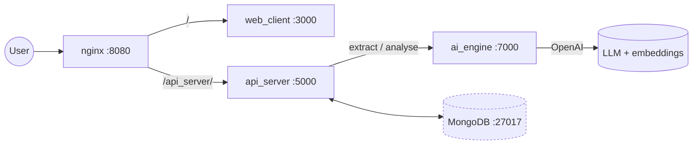

# SmartHire

An AI screening pipeline for recruitment: upload CVs, upload a job description, and get a structured candidate profile plus a scored match with written reasoning on the strengths and the risks.

The interesting part is not the score, it is how the score is weighted. A fixed rubric ("education 20%, experience 30%...") is wrong for most jobs: a warehouse role and a backend role should not be scored the same way. SmartHire derives the weights from the job description itself before it scores anyone.

## How a match is produced

```
CV (PDF/DOCX)
  -> text extraction            LandingAI ADE, avatar cropped with PyMuPDF
  -> structured profile         LLM + pydantic schema: degree, experience,
                                technical skills, certificates, languages
Job description
  -> job context analysis       stage 1: what does this role actually demand?
  -> dynamic weights            stage 2: weights per criterion, justified
Both
  -> per-criterion scoring      each of degree, experience, technical_skill,
                                responsibility, certificate, soft_skill, language
  -> weighted total             sum(score x weight) / sum(weight), rounded
  -> written reasoning          success predictors and risk factors
```

Both stages of the weighting run as separate LLM calls with low temperature, and fall back to static weights when `OPENAI_API_KEY` is absent, so the service degrades instead of failing. Scoring keeps a fallback result too: if a match analysis throws, the record is written with neutral 50s and a "please retry" comment rather than a broken row.

## Services

| Service | Stack | Port | Role |
|---|---|---|---|
| `web_client` | Next.js, React, Tailwind | 3000 | dashboard: upload CVs, manage jobs, read results |
| `api_server` | FastAPI, Motor, uv | 5000 | owns the data, persists to MongoDB, calls the AI engine |
| `ai_engine` | FastAPI, LangChain, uv | 7000 | extraction, job analysis, matching; the only LLM caller |
| `mongo_db` | MongoDB 4.4 | internal only | candidates, jobs, match records |
| `nginx` | nginx 1.27 | 8080 | single entry point, gzip, rate limiting |

Networks are split: `frontend_net` carries nginx to the web client, `backend_net` carries nginx, the API, the AI engine and MongoDB. The database port is not published to the host, and nginx has a 16 MB upload ceiling and per-IP rate limits (10 r/s on the API, 30 r/s on the web client).



## Running it

Prerequisites: Docker with Compose v2, and an OpenAI key (LandingAI is optional, used for PDF parsing).

```bash
cp .env.example .env                      # set MONGO_ROOT_PASSWORD
cp ai_engine/.env.example ai_engine/.env  # set OPENAI_API_KEY
cp api_server/.env.example api_server/.env.local   # set MONGO_URL, SECRET_KEY, AI_ENGINE_URL
docker compose up -d --build
```

The `mongo` user, password and database name in `MONGO_URL` must match the root credentials in `.env`, because the API connects through `backend_net` using the service name `mongo_db`.

Then:

- dashboard: http://localhost:8080
- API docs: http://localhost:8080/api_server/docs
- AI engine health: `docker compose exec ai_engine python -c "import urllib.request;print(urllib.request.urlopen('http://localhost:7000/healthz').status)"`

### Without Docker

```bash
# 1. MongoDB reachable on localhost:27017
# 2. ai engine
cd ai_engine && uv sync && uv run uvicorn app:app --port 7000 --reload
# 3. api server (set MONGO_URL to localhost before this)
cd api_server && uv sync && uv run uvicorn app.main:app --port 5000 --reload
# 4. web client (set NEXT_PUBLIC_API_URL=http://localhost:5000)
cd web_client && npm install && npm run dev
```

## API

Everything is reached through nginx under `/api_server`; the paths below are the API's own.

| Method | Path | Purpose |
|---|---|---|
| POST | `/upload-cv` | upload a CV, extract and store the structured profile |
| POST | `/list-candidate` | paged candidate list |
| GET, PUT, DELETE | `/candidate/{id}` | read, update, delete a candidate |
| GET | `/job`, POST `/job` | list and create jobs |
| POST | `/job-page` | paged job list |
| GET, PUT, DELETE | `/job/{id}` | single job |
| POST | `/process-matching` | score one candidate against one job |
| POST | `/process-matching-selective` | score a candidate against selected criteria |
| GET, POST | `/data-matching` | stored match records |
| GET | `/candidate/{cid}/job/{jid}` | the match for a pair |
| GET | `/health` | API liveness (also `/avatars/{file}` for candidate photos) |

The AI engine exposes `POST /candidate/analyse`, `POST /job/analyse`, `POST /matching/analyse` and `GET /healthz`. It is called only by the API server, never by the browser.

## Configuration

- `api_server/.env.local`: `MONGO_URL`, `MONGO_TEST_URL`, `AI_ENGINE_URL`, `SECRET_KEY`, `API_PORT`, `WORKERS`, `OPENAI_API_KEY`.
- `ai_engine/.env`: `OPENAI_API_KEY` (required), `LANDINGAI_API_KEY` (PDF parsing), `GOOGLE_API_KEY` (unused, kept for the provider switch).
- Scoring behaviour lives in `ai_engine/src/matching/config.py`; prompts per stage in `ai_engine/src/matching/prompts.py`.

## Code quality and tests

Lint and format with `ruff check .` and `ruff format .` (config in `ruff.toml`). `scripts/test_refactoring.py` exercises the API surface against a running stack; there is **no automated test suite or CI pipeline** yet, so treat the service as manually verified.

## What this does not do

- **No authentication.** `SECRET_KEY` is configured but no auth middleware consumes it; the API is open and CORS is `*`. Put it behind real auth before it holds a real candidate database, and note that CVs are personal data under most privacy regimes.
- **No tests, no CI.** See above.
- **Image tags are placeholders.** `chris123/*` in `docker-compose.yml` point at images that are not published; the build step is what you actually run.
- **No queue.** Long analyses run inside the request; a slow CV blocks that request until the model answers.
- **Single node.** No sharding, no replica set, no backup job for the MongoDB volume.
- **Matching is not benchmarked.** There are no labelled pairs, so the scores are not validated against human recruiter judgement.

## License

MIT. See [LICENSE](LICENSE).

Built by [Hoang Hieu Nguyen](https://github.com/chrisHHieu).
