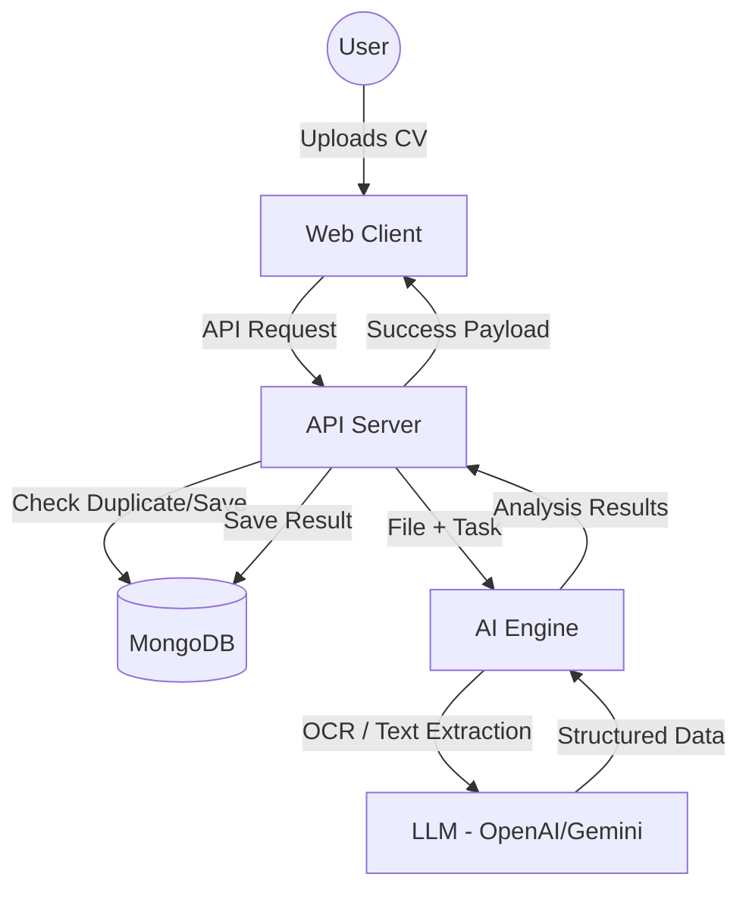

# SmartHire - AI-Powered Recruitment Matching System

SmartHire is a modern recruitment ecosystem that leverages Artificial Intelligence to analyze candidate CVs and evaluate their compatibility with Job Descriptions. The project automates the screening process, providing deep insights into candidate strengths, risks, and overall matching scores.

## 🚀 Key Features

*   **Automated CV Parsing**: Deep extraction of candidate details from PDF/Docx using OCR and LLMs.
*   **Intelligent Matching**: Proprietary algorithms to match candidates against specific job requirements.
*   **AI Insights**: Detailed reasoning on Success Predictors and Risk Factors for every candidate.
*   **Production-Ready**: High-performance architecture using FastAPI, Next.js, and `uv` for dependency management.

## 🏗️ System Architecture

The project consists of 4 main services:

1.  **`web_client`**: Frontend dashboard built with Next.js (React).
2.  **`api_server`**: RESTful API Backend built with FastAPI.
3.  **`ai_engine`**: High-performance AI service for OCR and LLM processing.
4.  **`mongo_db`**: NoSQL database for structured candidate and job data.
5.  **`nginx`**: Reverse proxy for traffic orchestration.

## 🔄 High-Level Workflow



---

## 🛠️ Getting Started

### Method 1: Using Docker (Recommended)

**Prerequisites**: Docker and Docker Compose installed.

1.  **Configure Environment**:
    *   Create `api_server/.env.local` (see `api_server/.env.example`).
    *   Create `ai_engine/.env` and provide `OPENAI_API_KEY` or `GOOGLE_API_KEY`.

2.  **Launch**:
    ```bash
    docker compose up -d --build
    ```

3.  **Access**:
    *   Dashboard: [http://localhost:8080](http://localhost:8080)
    *   API Docs: [http://localhost:8080/api_server/docs](http://localhost:8080/api_server/docs)

---

### Method 2: Manual Run (No Docker)

#### 1. Database
Run MongoDB at `localhost:27017`.

#### 2. AI Engine
```bash
cd ai_engine
uv sync
uv run uvicorn app:app --port 7000 --reload
```

#### 3. API Server
```bash
cd api_server
uv sync
uv run uvicorn app.main:app --port 5000 --reload
```

#### 4. Web Client
```bash
cd web_client
npm install
npm run dev
```

---

## 📄 License

Copyright © 2025 SmartHire Team. All rights reserved.
