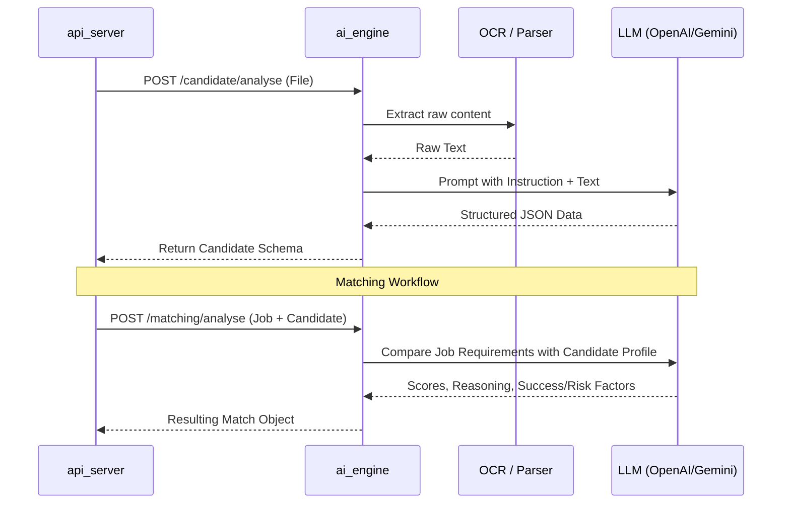

# ai_engine - AI & OCR Analysis Service

`ai_engine` is the analytical core of the SmartHire system, responsible for deep CV parsing and intelligent matching logic using Large Language Models (LLMs).

## 🌟 Core Functionalities

-   **Smart Parsing**: Extracting structured markdown and avatars from PDF files using **LandingAI ADE SDK**.
-   **Docx Extraction**: Fast text extraction from Word documents using **docx2txt**.
-   **Avatar Detection**: Automatically identifying and cropping candidate photos using **PyMuPDF**.
-   **Structured Extraction**: Identifying key entities like Name, Email, Skills, and Experience from unstructured text via LLMs.
-   **Matching Logic**: Calculating multi-dimensional compatibility scores based on job requirements.

## 🔄 Logic Workflow



## 🛠️ Tech Stack

-   **Runtime**: Python 3.11
-   **Framework**: FastAPI
-   **Package Manager**: `uv` (Production standard)
-   **Main Libraries**: LangChain, Pydantic, PyMuPDF, LandingAI ADE.

## 🚀 Running the Service

### via Docker
```bash
docker compose up -d --build ai_engine
```

### Manual Run
1.  **Install dependencies**: `uv sync`
2.  **Environment**: Fill `.env` with required API keys.
3.  **Run**: `uv run uvicorn app:app --port 7000 --reload`
