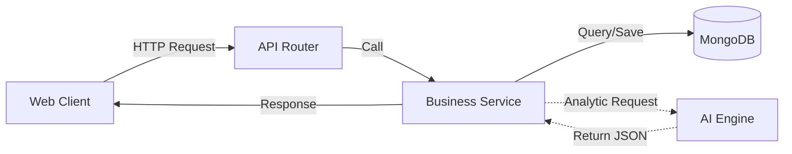

# api_server - REST API Backend Service

The `api_server` acts as the primary orchestrator, managing data persistence, business logic flow, and coordinating communication between the Frontend and the AI Engine.

## 🌟 Core Functionalities

-   **Candidate Management**: Lifecycle management (CRUD) of candidate profiles and CV metadata.
-   **Job Management**: Handling job descriptions and recruitment requirements.
-   **Match Orchestration**: Triggering analysis tasks in `ai_engine` and consolidating results into MongoDB.
-   **Data Serialization**: Custom handling of MongoDB BSON types (ObjectId, datetime) for clean JSON responses.

## 🔄 Data & Request Flow



## 🛠️ Tech Stack

-   **Runtime**: Python 3.11
-   **Framework**: FastAPI (Asynchronous)
-   **Database**: MongoDB (via PyMongo)
-   **Package Manager**: `uv`
-   **Serialization**: Custom Pydantic models & JSON encoders.

## 🚀 Running the Service

### via Docker
```bash
docker compose up -d --build api_server_service
```

### Manual Run
1.  **Dependencies**: `uv sync`
2.  **Environment**: Create `.env.local` with `MONGO_URL` and `AI_ENGINE_URL`.
3.  **Run**: `uv run uvicorn app.main:app --port 5000 --reload`

## 📁 Directory Structure

-   `app/main.py`: FastAPI initialization and middleware.
-   `app/routers/`: API endpoints organized by domain.
-   `app/services/`: Pure business logic and AI orchestration.
-   `app/schemas/`: Pydantic models for validation and serialization.
-   `app/database.py`: Singleton database client.
