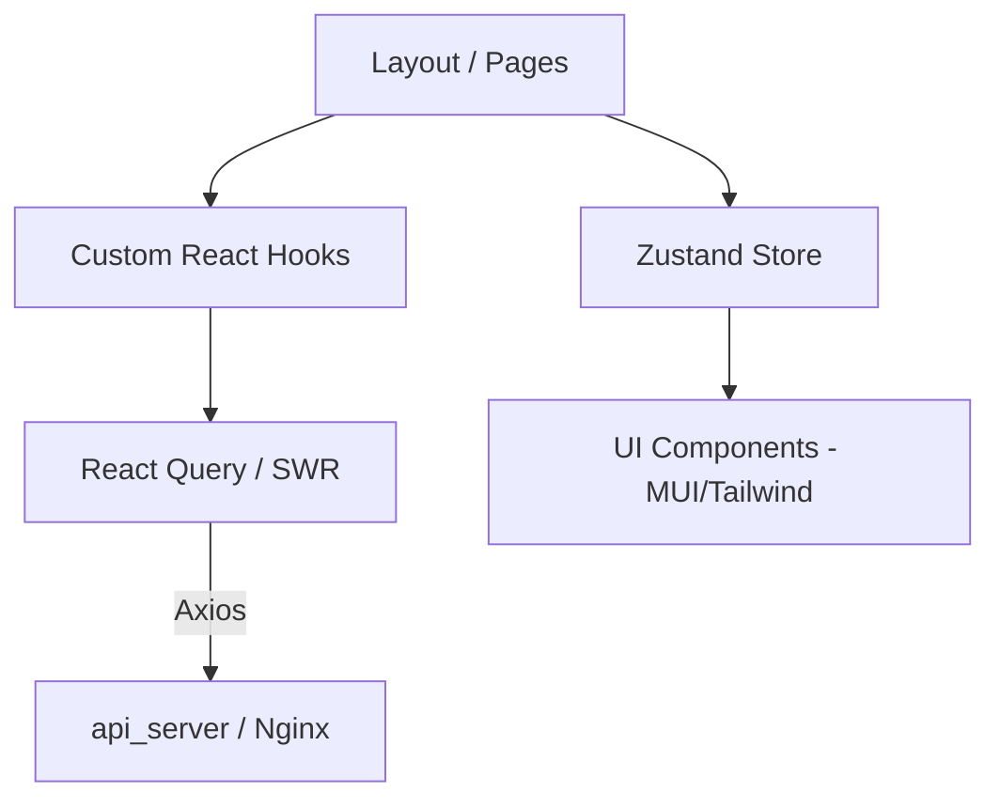

# web_client - Next.js Frontend Dashboard

The `web_client` provides a sophisticated user interface for recruiters to interact with the SmartHire AI ecosystem. It offers a seamless experience for managing talent pools and analyzing job fitness.

## 🌟 Core Functionalities

-   **Recruitment Dashboard**: Top-level metrics and system overviews.
-   **Intelligent Lists**: Data-rich tables with advanced filtering, sorting, and pagination.
-   **AI Detail View**: Side-drawers displaying AI-generated analysis, skill charts, and reasoning logs.
-   **Real-time Interaction**: Instant CV uploading and dynamic background status updates.
-   **Theming**: Full support for Dark Mode for reduced eye strain and consistent aesthetics.

## 🎨 UI/UX Architecture



## 🛠️ Tech Stack

-   **Framework**: Next.js 14 (App Router)
-   **Styling**: Tailwind CSS & Material UI (MUI)
-   **State Management**: Zustand
-   **Data Fetching**: React Query (TanStack Query)
-   **Animations**: Framer Motion

## 🚀 Running the Client

### via Docker
```bash
docker compose up -d --build web_client_service
```

### Manual Run
1.  **Dependencies**: `npm install`
2.  **Dev Server**: `npm run dev`
3.  **Production Build**:
    ```bash
    npm run build
    npm start
    ```
